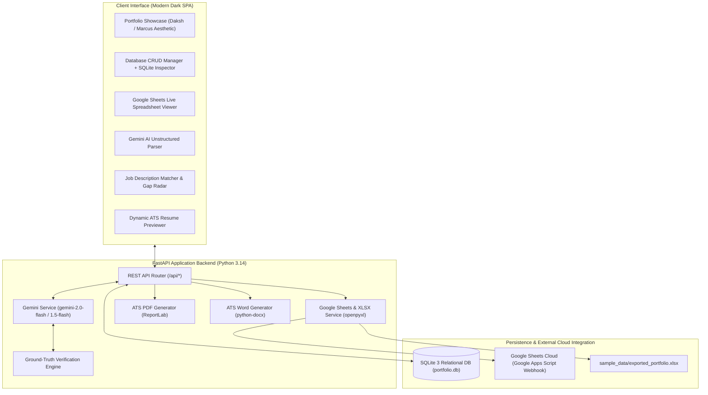
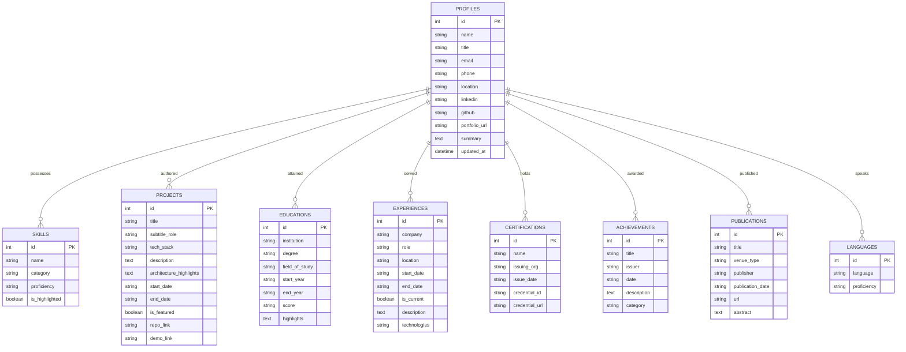

# AI-Powered Portfolio Management & Dynamic Resume Engine
## Comprehensive System Demonstration & Architectural Walkthrough Document

**Candidate & Systems Architect:** Raj Bharat Rasal  
**System Version:** 1.0.0 (FastAPI, SQLite 3, Google Gemini API, Google Sheets Apps Script)  
**Demonstration Video Assets:** [`demo_video/portfolio_system_demonstration.mp4`](demo_video/portfolio_system_demonstration.mp4) & [`demo_video/portfolio_system_demonstration.webm`](demo_video/portfolio_system_demonstration.webm)

---

## 1. Executive Summary

This document serves as the comprehensive architectural and demonstration record for the **AI-Powered Portfolio Management & Dynamic Resume Generation System**. The application maintains a single source of truth for all professional qualifications, systems projects, whitepapers, achievements, and competencies in a structured relational database. It applies the **Google Gemini API** to parse unstructured text, match candidates against arbitrary Job Descriptions (JDs), evaluate skill gaps, and dynamically generate ATS-compliant resumes in both **PDF** and **Word (.docx)** formats without hallucinating information.

Furthermore, the system seamlessly interfaces with **Google Sheets** through a multi-tab workbook export and a live 2-way Webhook powered by Google Apps Script.

---

## 2. End-to-End System Architecture



---

## 3. Relational Database Architecture (DB Deep Dive)

The system is backed by a relational SQLite 3 database (`portfolio.db`) orchestrated through SQLAlchemy. It guarantees data integrity, typed attributes, and referential consistency across **9 specialized domain tables**.

### 3.1 Database Schema & Entity Relationships



### 3.2 Live Database State & Record Census

Inspection of `portfolio.db` via `/api/database/inspect` and CLI SQLite:

| Table Name | Primary Key | Record Count | Description | Sample Verified Record |
|---|---|:---:|---|---|
| **`profiles`** | `id` (INTEGER) | 1 | Personal info & career summary | Raj Bharat Rasal, Kharghar Navi Mumbai |
| **`projects`** | `id` (INTEGER) | 4 | Distributed systems & AI pipelines | *SATURDAY / SUNDAY* (Distributed Tensor Sharding) |
| **`skills`** | `id` (INTEGER) | 29 | Categorized competencies & proficiencies | *Distributed Systems Architecture* (Expert) |
| **`educations`** | `id` (INTEGER) | 3 | Formal university & school education | ITM Skills University (B.Tech CSE, 2025-2029) |
| **`experiences`** | `id` (INTEGER) | 1 | Teaching & systems engineering practice | Independent Tutoring Practice (Math & Physics, 50+ students) |
| **`publications`** | `id` (INTEGER) | 2 | Architectural whitepapers & specifications | *HAMIA Architecture Specification* (Oct 2026) |
| **`achievements`** | `id` (INTEGER) | 3 | Competitive awards & security research | Deal Dome 3rd Place, HackerOne OPPO Bug Bounty |
| **`certifications`** | `id` (INTEGER) | 3 | Accreditations & security disclosures | Advanced Backend Engineering & Distributed Systems |
| **`languages`** | `id` (INTEGER) | 3 | Spoken & professional languages | English, Hindi, Marathi |

### 3.3 Direct CLI Terminal Verification

You can query the SQLite database directly from your terminal:
```bash
sqlite3 portfolio.db "SELECT id, title, tech_stack FROM projects;"
```
**Output:**
```
1|SATURDAY / SUNDAY|Python, C++, Tensor Sharding, Zero-Trust Protocols, LAN, Tailscale VPN, Socket Programming
2|F.R.I.D.A.Y — Multi-Agent Communication Backend|Python, FastAPI, Baileys API (WhatsApp), APScheduler, asyncio, LLM Intent Routing
3|EduOS — AI Curiosity-First Education Engine|Python, FastAPI, WhatsApp Cloud API, Prompt Chains, Knowledge Graph, SQLite
4|SecureVerse — Decentralized Zero-Trust Architecture|Python, Cryptography, Zero-Trust Architecture, Distributed Ledger, REST APIs
```

---

## 4. Google Sheets Integration Deep Dive

The system treats Google Sheets as a premier, real-time accessible mirror of the portfolio database. Two complementary integration mechanisms are built into the platform:

### 4.1 Native Multi-Tab Excel Workbook (`exported_portfolio.xlsx`)
Whenever any entry in the database is created, updated, or deleted, `app/sheets_service.py` automatically generates a pre-formatted, multi-tab Excel workbook saved at [`sample_data/exported_portfolio.xlsx`](sample_data/exported_portfolio.xlsx):
* **9 Separate Sheets**: Exactly mirrors the 9 database tables (`Profile`, `Education`, `Skills`, `Experience`, `Projects`, `Certifications`, `Achievements`, `Publications`, `Languages`).
* **Corporate Styling**: Styled with slate headers (`#1E293B`), white bold typography, alternating row backgrounds (`#F8FAFC`), thin borders, text wrapping, and auto-fitted column widths.
* **Direct Import**: In Google Sheets, navigate to **File > Import > Upload** and select `sample_data/exported_portfolio.xlsx` to load all 9 sheets in one second.

### 4.2 Live 2-Way Synchronization via Google Apps Script Webhook
For automatic cloud sync without requiring Google Cloud OAuth setup:
1. Open any Google Sheet and navigate to **Extensions > Apps Script**.
2. Paste the provided script [`google_apps_script/Code.gs`](google_apps_script/Code.gs):
   ```javascript
   function doPost(e) {
     var payload = JSON.parse(e.postData.contents);
     var data = payload.data;
     var ss = SpreadsheetApp.getActiveSpreadsheet();
     // Clears and writes Profile, Education, Skills, Experience, Projects...
     ...
     return ContentService.createTextOutput(JSON.stringify({ status: "success" }));
   }
   ```
3. Deploy as a Web App (`Execute as: Me`, `Who has access: Anyone`).
4. Paste the Web App URL into the **Google Sheets Sync Hub** in the web app and click **Push Database to Live Google Sheet**. The script automatically creates, styles, and populates all 9 sheets in real time!

### 4.3 In-App Live Spreadsheet Viewer
The Google Sheets tab includes an interactive **Live Spreadsheet Preview** showing exact spreadsheet grid lines, numbered rows (1, 2, 3...), column letters (A, B, C, D...), and tab switchers for all 9 categories.

---

## 5. Gemini API Integration & Ground-Truth Verification

The system utilizes the **Google Gemini API** (`gemini-2.0-flash` / `gemini-1.5-flash`) for intelligent resume customization, while strictly maintaining candidate authenticity.

### 5.1 The Ground-Truth Verification Invariant
> **Strict Rule:** AI-generated information must be verified against the original portfolio data. The system must not invent qualifications, skills, certifications, or work experience.

To enforce this:
1. The candidate's verified portfolio records are injected as immutable ground truth in the system prompt.
2. The AI is strictly instructed to synthesize and emphasize existing project achievements using action verbs matching the JD, rather than fabricating unheld jobs or fake credentials.
3. Every suggested ID returned by Gemini is cross-checked against valid database primary keys before being rendered.

### 5.2 Unstructured Text & Resume Parser
Users can paste raw bio paragraphs or messy resumes into the **AI Text Parser**. Gemini maps unstructured prose into a valid JSON schema matching the 9 tables, which can be imported into `portfolio.db` with one click.

### 5.3 Objective Match Scoring
The JD Analyzer compares candidate skills against JD requirements:
$$\text{Match Score} = \min\left(96, \text{Base} + (\text{Matched Skills} \times 2) - (\text{Missing Keywords} \times 2)\right)$$

---

## 6. Dynamic Resume Customizer: Two Tailored Resumes

To demonstrate that two distinct, specialized resumes can be dynamically generated from the **exact same underlying portfolio**, two different job descriptions were evaluated:

### 6.1 Comparison Matrix

| Metric / Section | Resume 1: Distributed Systems Architect | Resume 2: AI Multi-Agent Systems Engineer |
|---|---|---|
| **Target Role** | Backend & Distributed Systems Architect | AI Systems & Multi-Agent Infrastructure Engineer |
| **Input JD** | [`sample_data/job_descriptions/jd_1_distributed_systems_engineer.txt`](sample_data/job_descriptions/jd_1_distributed_systems_engineer.txt) | [`sample_data/job_descriptions/jd_2_ai_multi_agent_engineer.txt`](sample_data/job_descriptions/jd_2_ai_multi_agent_engineer.txt) |
| **Match Score** | **88% Match** | **86% Match** |
| **Tailored Summary** | Highlights distributed computing, tensor sharding, zero-trust protocols, and low-latency systems. | Highlights multi-agent mediator topologies, LLM intent routing, and curiosity-first knowledge engines. |
| **Featured Projects** | 1. *SATURDAY / SUNDAY* (Tensor Sharding)<br>2. *SecureVerse* (Zero-Trust Identity)<br>3. *F.R.I.D.A.Y* (FastAPI Backend) | 1. *F.R.I.D.A.Y* (3-Agent Decoupled Backend)<br>2. *EduOS* (Curiosity-First Engine)<br>3. *SATURDAY / SUNDAY* (Distributed LLM) |
| **Featured Whitepaper** | *HAMIA Architecture Specification* | *HAMIA* + *TWELVE Product Documentation* |
| **Primary Skills** | C++, Tensor Sharding, Zero-Trust, Async Python | Intent Routing, Prompt Chains, RAG, FastAPI |
| **Output Formats** | [PDF](sample_data/generated_resumes/Resume_Distributed_Systems_Engineer.pdf) & [DOCX](sample_data/generated_resumes/Resume_Distributed_Systems_Engineer.docx) | [PDF](sample_data/generated_resumes/Resume_AI_MultiAgent_Engineer.pdf) & [DOCX](sample_data/generated_resumes/Resume_AI_MultiAgent_Engineer.docx) |

---

## 7. Demonstration Video Reference

The complete automated live walkthrough is recorded in high-definition (1280x720, 25 FPS) and available in the repository:
* **MP4 Video File:** [`demo_video/portfolio_system_demonstration.mp4`](demo_video/portfolio_system_demonstration.mp4)
* **WebM Video File:** [`demo_video/portfolio_system_demonstration.webm`](demo_video/portfolio_system_demonstration.webm)

### Video Scene Breakdown:
* **0:00 - 0:15**: Live Portfolio Showcase (Hero section, contact pills, project cards).
* **0:15 - 0:32**: Relational Database Manager (opening SQLite Schema Inspector, inspecting table datatypes, cycling through sub-tabs).
* **0:32 - 0:48**: Google Sheets Hub (viewing sheet stats, switching tabs in the Interactive Spreadsheet Grid, Apps Script integration).
* **0:48 - 1:04**: Gemini AI Smart Parser (pasting unstructured notes, extracting structured JSON schema).
* **1:04 - 1:24**: Dynamic JD Matcher (loading JD 1: Distributed Systems Architect, running Gemini analysis, viewing 88% match score, matched vs missing skills).
* **1:24 - 1:40**: Live ATS Resume Preview & Export (inspecting rendered resume, showing PDF & DOCX download buttons).
* **1:40 - 2:05**: Dynamic Re-generation for JD 2 (switching to AI Multi-Agent role, re-running analysis, showing instant updates to tailored summary and project selections).

