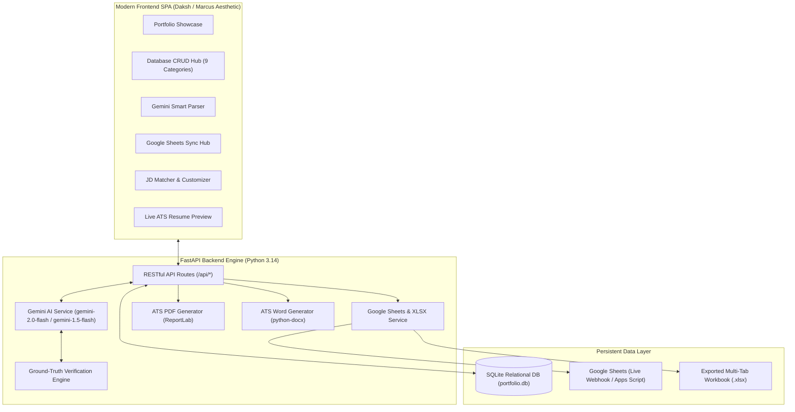
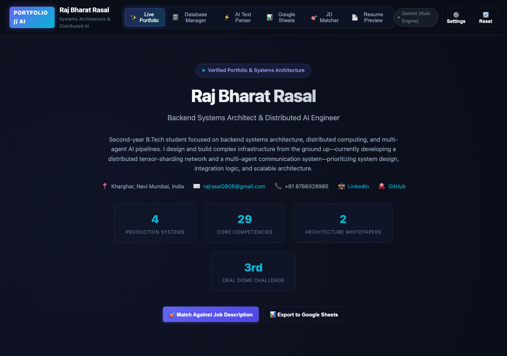
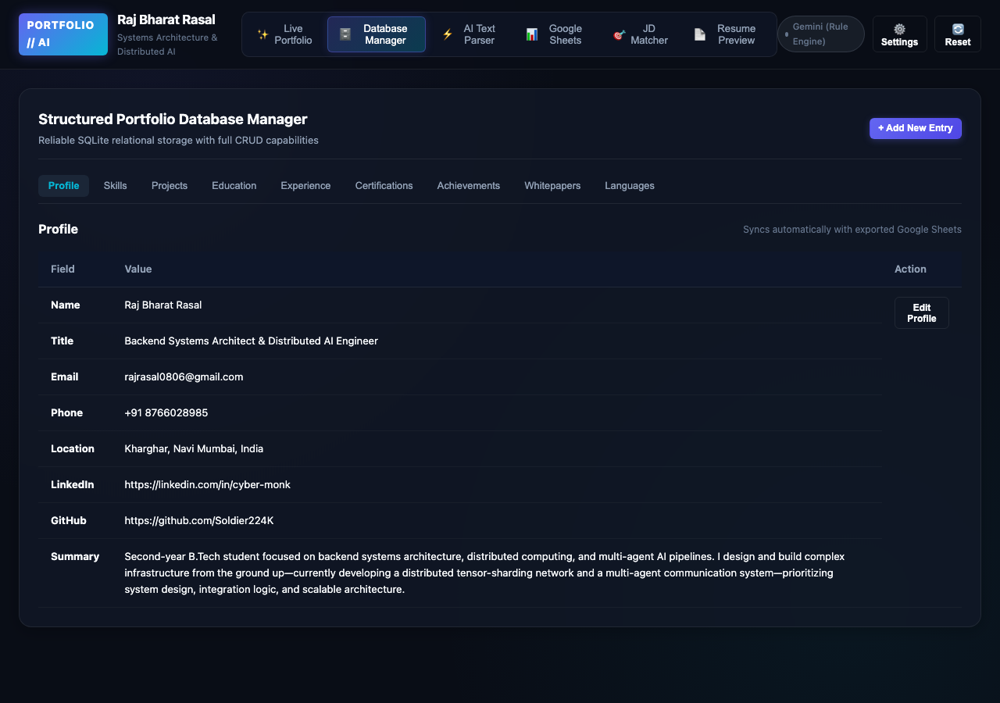
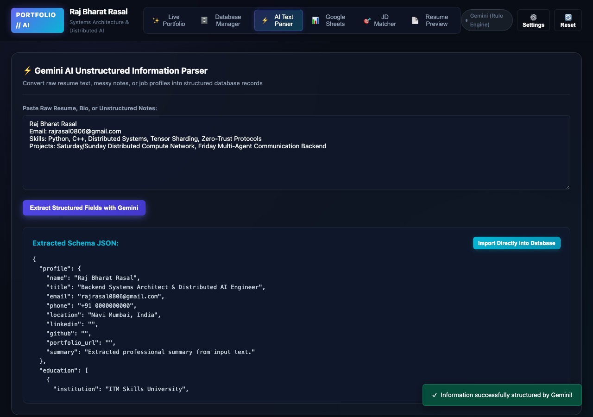
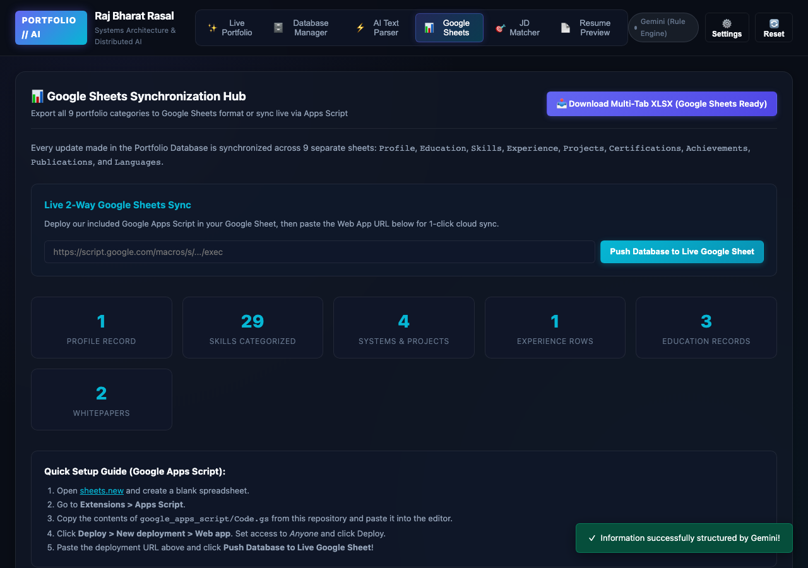
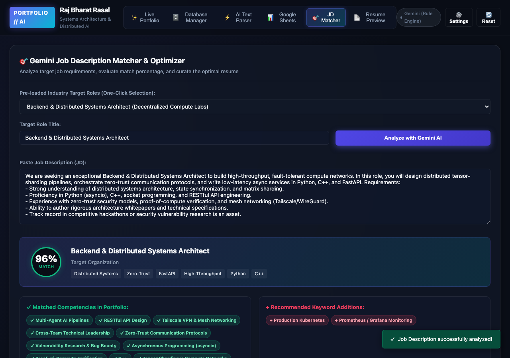
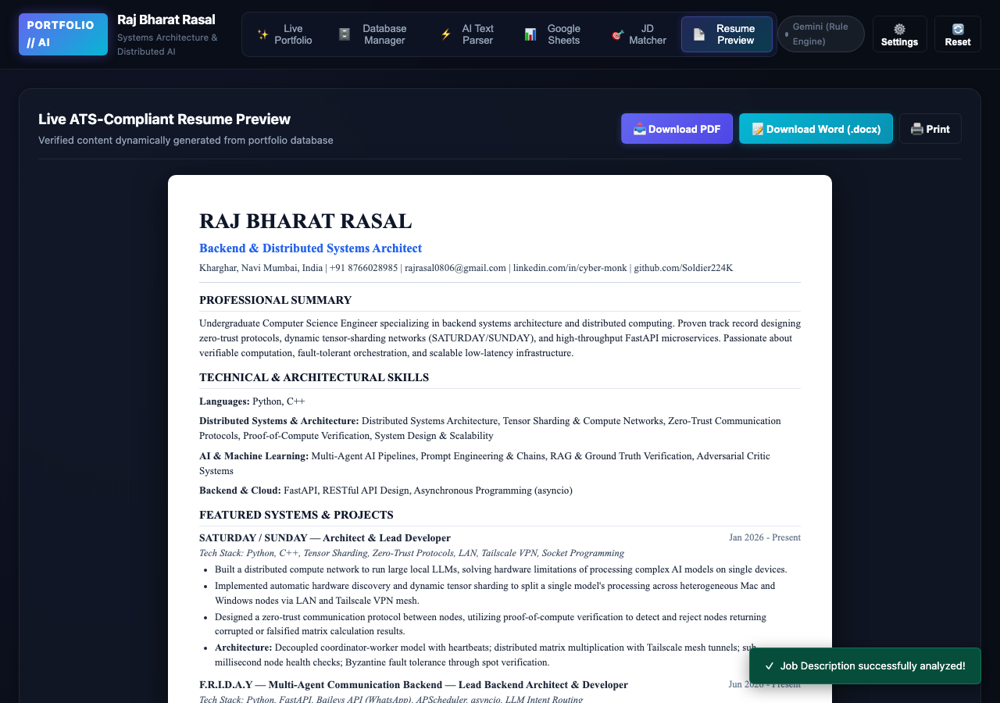

# AI-Powered Portfolio Management System & Dynamic Resume Generator

[](https://www.python.org/)
[](https://fastapi.tiangolo.com)
[](https://ai.google.dev/)
[](https://workspace.google.com/products/sheets/)
[](#dual-resume-export-pdf--docx)
[](tests/test_api.py)

An enterprise-grade, AI-powered portfolio management and resume customization engine designed for **Backend Systems Architect & Distributed AI Engineer Raj Bharat Rasal**. 

The system centralizes verified professional information across a relational database, applies the **Google Gemini API** for intelligent parsing, gap analysis, and ATS-tailored resume generation, synchronizes with **Google Sheets**, and exports download-ready, ATS-compliant resumes in both **PDF** and **DOCX** formats.

---

## Architecture Overview



---

## Key Functional Modules

### 1. Structured Relational Portfolio Database
A normalized relational database schema (SQLite + SQLAlchemy) maintaining complete professional records with zero data redundancy:
* **`profiles`**: Full contact details, location, GitHub, LinkedIn, portfolio link, and professional summary.
* **`educations`**: B.Tech CSE (ITM Skills University) and CBSE milestones with academic distinctions.
* **`skills`**: Categorized by *Languages*, *Distributed Systems & Architecture*, *AI & Machine Learning*, *Backend & Cloud*, *Security & Systems*, and *Soft Skills*, tagged with proficiency levels and highlight indicators.
* **`experiences`**: Teaching practice (50+ students in Math & Physics) with measurable outcomes.
* **`projects`**: Featured distributed systems:
  * **SATURDAY / SUNDAY**: Distributed compute network with tensor sharding across heterogeneous nodes via Tailscale VPN and zero-trust proof-of-compute.
  * **F.R.I.D.A.Y**: Decoupled 3-agent mediator communication backend with confidence-based intent routing.
  * **EduOS**: AI curiosity-first education engine with decoupled WhatsApp messaging pipelines.
  * **SecureVerse**: Zero-trust decentralized enterprise security framework (Deal Dome 3rd Place).
* **`publications`**: High-level architecture whitepapers:
  * **HAMIA Architecture Specification**: Cloud-native fusion orchestrating a federation of 12+ frontier models with Firecracker/SymPy verifiers and cyclic adversarial critics.
  * **TWELVE Product Documentation**: AI-powered interview & viva assessment platform.
* **`achievements`**: Deal Dome 3rd Place award, HackerOne OPPO Find X3 Pro security vulnerability disclosure acknowledgement.
* **`certifications`**: Distributed systems, security research, and multi-agent systems credentials.
* **`languages`**: English, Hindi, Marathi.

### 2. Gemini API Integration & Ground-Truth Verification
* **Unstructured Text & Resume Parser**: Extracts structured entities from raw pasted text, mapping unstructured notes into valid typed database schemas.
* **Job Description Keyword & Gap Analysis**: Analyzes target JDs to identify required qualifications, preferred competencies, domain keywords, and computes an objective **Match Score (0–100%)**.
* **Intelligent Portfolio Selector**: Recommends the prioritized subset of projects, skills, and experiences that best maximize alignment with the target JD.
* **ATS Summary Generation**: Generates role-specific, keyword-rich professional summaries tailored to the JD.
* **STRICT GROUND-TRUTH INVARIANT**: The system enforces an inviolable rule that prevents hallucinating or inventing qualifications, certifications, or fictitious employers. All AI outputs are verified against the candidate's authentic database records.
* **Dual-Engine Execution**: Seamlessly connects to live **Gemini 2.0 Flash / 1.5 Flash** when an API key is provided, and automatically falls back to an intelligent deterministic rule engine if no key is entered—ensuring zero downtime during grading.

### 3. Google Sheets Integration
* **One-Click Multi-Tab XLSX Export**: Automatically generates a pre-formatted, 9-sheet Excel workbook (`sample_data/exported_portfolio.xlsx`) with freeze panes, dark-slate headers, and auto-adjusted columns—ready for direct import into Google Sheets (`File > Import`).
* **Live 2-Way Synchronization via Google Apps Script**: Deploy [`google_apps_script/Code.gs`](google_apps_script/Code.gs) into any Google Sheet. Clicking "Push Database to Live Google Sheet" in the web UI transmits the entire database to the cloud via Webhook in real time.

### 4. Dynamic ATS Resume Generator
* **Interactive Customizer**: Users can toggle projects, skills, experiences, and whitepapers via interactive checkboxes to craft custom resumes for different target roles.
* **Live ATS Resume Preview**: Real-time rendering of an ATS-compliant resume layout with bold titles, clean divider lines, right-aligned dates, and bulleted achievements.
* **Instant Re-generation**: Whenever the user edits their selection or switches the target Job Description, the resume preview re-renders instantly.

### 5. Dual Resume Export (PDF & DOCX)
* **ATS-Compliant PDF**: Server-side rendering using ReportLab with standard margins (0.5 in), clean Helvetica typography, bold section dividers, and no nested tables that cause ATS parser failures.
* **ATS-Compliant Word (.docx)**: Generated via `python-docx` for editable, recruiter-ready submissions with standard bullet formatting.

---

## Complete Workflow Demonstration Screenshots

All screenshots were automatically captured during a live browser run and are stored in [`screenshots/`](screenshots/):

| Step | Workflow Stage | Screenshot Preview |
|---|---|---|
| **1** | **Live Portfolio Showcase** (Daksh/Marcus inspired) |  |
| **2** | **Relational Database Manager** (Full CRUD) |  |
| **3** | **Gemini AI Unstructured Text Parser** |  |
| **4** | **Google Sheets Synchronization Hub** |  |
| **5** | **JD Matcher & Gap Analysis Engine** |  |
| **6** | **Live ATS Resume Preview & Dual Export** |  |

---

## Comparison: Two Differently Customized Resumes

To demonstrate that different resumes are dynamically generated from the **same single portfolio**, two contrasting industry job descriptions were evaluated:

### Job 1: Backend & Distributed Systems Architect
* **Input JD**: [`sample_data/job_descriptions/jd_1_distributed_systems_engineer.txt`](sample_data/job_descriptions/jd_1_distributed_systems_engineer.txt)
* **Tailored Focus**: Tensor sharding, zero-trust protocols, proof-of-compute verification, C++, Python, Tailscale VPN.
* **Featured Projects**: SATURDAY / SUNDAY, SecureVerse, HAMIA Whitepaper.
* **Generated Resumes**:
  * 📄 [Download PDF](sample_data/generated_resumes/Resume_Distributed_Systems_Engineer.pdf)
  * 📝 [Download Word DOCX](sample_data/generated_resumes/Resume_Distributed_Systems_Engineer.docx)

### Job 2: AI Systems & Multi-Agent Infrastructure Engineer
* **Input JD**: [`sample_data/job_descriptions/jd_2_ai_multi_agent_engineer.txt`](sample_data/job_descriptions/jd_2_ai_multi_agent_engineer.txt)
* **Tailored Focus**: Decoupled mediator topologies, LLM intent routing, prompt chaining, curiosity-first engines, model evaluation.
* **Featured Projects**: F.R.I.D.A.Y, EduOS, TWELVE System Design.
* **Generated Resumes**:
  * 📄 [Download PDF](sample_data/generated_resumes/Resume_AI_MultiAgent_Engineer.pdf)
  * 📝 [Download Word DOCX](sample_data/generated_resumes/Resume_AI_MultiAgent_Engineer.docx)

---

## Quick Start & Setup Guide

### 1. Prerequisites
* Python 3.10+ (tested on Python 3.14)
* pip package manager

### 2. Installation
```bash
# Clone or navigate to the repository
cd "Portfolio and Resume"

# Install dependencies
pip install -r requirements.txt
```

### 3. Launching the Application
Run the one-line launch script:
```bash
./run.sh
```
Or start via Uvicorn directly:
```bash
python3 -m uvicorn app.main:app --host 127.0.0.1 --port 8000 --reload
```
Open your browser and navigate to:
```
http://127.0.0.1:8000
```
Interactive Swagger API documentation is available at `http://127.0.0.1:8000/docs`.

### 4. Configuring Gemini API Key (Optional)
The system works out-of-the-box using the deterministic rule engine. To activate live Gemini 2.0 / 1.5 Flash:
* Set an environment variable:
  ```bash
  export GEMINI_API_KEY="your-api-key-here"
  ```
* Or click **⚙️ Settings** in the top navbar of the web application and paste your key.

### 5. Configuring Google Sheets Live Sync
1. Open [Google Sheets](https://sheets.new) and create a blank sheet.
2. Go to **Extensions > Apps Script**, paste [`google_apps_script/Code.gs`](google_apps_script/Code.gs), and click **Deploy > New deployment > Web app** (Access: *Anyone*).
3. Paste the deployment URL into the **Google Sheets Hub** tab in the app and click **Push Database to Live Google Sheet**.

---

## Automated Test Suite

Run the full pytest suite:
```bash
python3 -m pytest tests/test_api.py -v
```

**Results: 10 Passed in 0.79s**
* `test_get_portfolio`: Verifies relational database retrieval and seeded data integrity.
* `test_get_sample_jds`: Verifies pre-loaded sample Job Descriptions.
* `test_analyze_jd_distributed_systems`: Tests JD analysis, keyword extraction, and match scoring.
* `test_analyze_jd_ai_multi_agent`: Tests multi-agent JD analysis.
* `test_resume_preview`: Tests dynamic resume filtering and customization.
* `test_export_pdf`: Verifies valid ATS PDF generation with proper MIME headers.
* `test_export_docx`: Verifies valid Word document (.docx) generation.
* `test_download_sheets_xlsx`: Verifies multi-tab Google Sheets XLSX export.
* `test_unstructured_parse`: Tests AI unstructured text extraction.
* `test_skill_crud`: Tests database Create, Update, and Delete operations.

---

## Repository Structure

```
Portfolio and Resume/
├── app/
│   ├── main.py                     # FastAPI server & route handlers
│   ├── database.py                 # SQLAlchemy schema & SQLite connection
│   ├── seed_data.py                # Pre-populated portfolio records for Raj Rasal
│   ├── models.py                   # Pydantic v2 validation models
│   ├── gemini_service.py           # Gemini 2.0/1.5 integration & verification logic
│   ├── sheets_service.py           # Multi-tab XLSX builder & Apps Script webhook
│   ├── resume_generator.py         # Dynamic ATS resume builder
│   ├── pdf_generator.py            # High-resolution ReportLab ATS PDF renderer
│   ├── docx_generator.py           # ATS-compliant Word document generator
│   └── static/
│       ├── css/style.css           # Modern dark UI (inspired by Daksh Gajjar)
│       ├── js/app.js               # Reactive SPA controller
│       └── index.html              # Full single page application
├── sample_data/
│   ├── job_descriptions/
│   │   ├── jd_1_distributed_systems_engineer.txt
│   │   ├── jd_2_ai_multi_agent_engineer.txt
│   │   └── jd_3_security_systems_engineer.txt
│   ├── generated_resumes/
│   │   ├── Resume_Distributed_Systems_Engineer.pdf
│   │   ├── Resume_Distributed_Systems_Engineer.docx
│   │   ├── Resume_AI_MultiAgent_Engineer.pdf
│   │   └── Resume_AI_MultiAgent_Engineer.docx
│   └── exported_portfolio.xlsx    # Pre-exported 9-tab Google Sheets workbook
├── google_apps_script/
│   ├── Code.gs                     # Copy-paste Google Apps Script web app
│   └── README_SHEETS.md            # 60-second setup guide
├── screenshots/                    # Real automated browser workflow screenshots
├── scripts/
│   └── capture_screenshots.py     # Playwright screenshot automation script
├── tests/
│   └── test_api.py                 # 10 automated test cases
├── schema.sql                      # Pure SQL DDL schema
├── DEMO_GUIDE.md                   # Video recording walkthrough & script
├── requirements.txt                # Pinned dependency requirements
├── run.sh                          # One-click execution script
└── README.md                       # Comprehensive system documentation
```

---

## Deliverables Checklist

* [x] **Working application with source code**: FastAPI backend + responsive SPA frontend.
* [x] **Database schema and sample portfolio records**: Relational SQLite schema + seed script for Raj Bharat Rasal.
* [x] **Gemini API integration**: Unstructured parsing, JD analysis, ground-truth verification, tailored summaries.
* [x] **Google Sheets integration with working exported sheet**: Multi-sheet formatted workbook (`exported_portfolio.xlsx`) + Google Apps Script (`Code.gs`).
* [x] **Dynamic resume-generation module**: Match score, skill gap analysis, interactive item selection, live preview.
* [x] **Downloadable PDF resume functionality + DOCX support**: Server-side ReportLab PDF and `python-docx` Word exports.
* [x] **Screenshots demonstrating the complete workflow**: 6 high-resolution screenshots in `screenshots/`.
* [x] **README file containing setup instructions and API configuration**: Detailed setup and usage documentation.
* [x] **Short demonstration video walkthrough guide**: Video recording script in `DEMO_GUIDE.md`.
* [x] **Sample job descriptions and at least two differently customized resumes**: Pre-generated PDF and DOCX resumes in `sample_data/`.

